# AIRemote 使用说明

> 版本 0.1.18 ｜ 适用系统：Windows 10 / 11（64 位）
> 一个本地运行的远程运维控制台：SSH / Telnet / 串口连交换机、路由器、服务器，自带终端、文件传输、配置备份和 AI 排障。

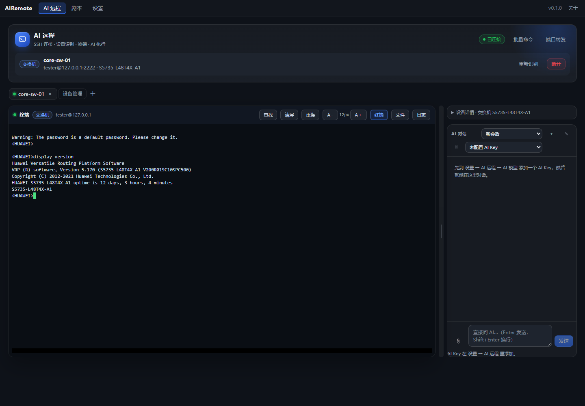

---

## 目录

1. [安装](#1-安装)
2. [第一次启动](#2-第一次启动)
3. [连接一台设备](#3-连接一台设备)
4. [终端怎么用](#4-终端怎么用)
5. [AI 对话](#5-ai-对话)
6. [命令模板](#6-命令模板)
7. [配置备份与对比](#7-配置备份与对比)
8. [批量导入已有设备](#8-批量导入已有设备)
9. [文件传输](#9-文件传输)
10. [端口转发](#10-端口转发)
11. [批量命令](#11-批量命令)
12. [剧本](#12-剧本)
13. [巡检与变更影响分析](#13-巡检与变更影响分析)
14. [拓扑与资产台账](#14-拓扑与资产台账)
15. [日志、录像与审计](#15-日志录像与审计)
16. [设置](#16-设置)
17. [自动更新](#17-自动更新)
18. [数据目录与备份](#18-数据目录与备份)
19. [常见问题](#19-常见问题)

---

## 1. 安装

下载页：<https://github.com/Ty-206/airemote-releases/releases>

| 形态 | 文件名 | 说明 |
| --- | --- | --- |
| 安装版（推荐） | `AIRemote-0.1.18-x64.exe` | 双击安装，可选目录，自动建桌面与开始菜单快捷方式，支持自动更新 |
| 便携版 | `AIRemote-0.1.18-portable.exe` | 免安装，双击即用，可以放 U 盘；不支持自动更新 |

**安装步骤**

1. 双击 `AIRemote-<版本>-x64.exe`
2. 若出现「Windows 已保护你的电脑」（SmartScreen）→ 点「更多信息」→「仍要运行」
   （程序暂未购买代码签名证书，属于正常提示）
3. 选择安装位置（默认 `D:\AIremote`），点「安装」
4. 装完自动打开

**卸载**：Windows 设置 → 应用 → 找到 AIRemote → 卸载。卸载只删程序，不会删你的连接与日志（在数据目录里，见第 18 节）。

---

## 2. 第一次启动

第一次打开会走两步，之后不再出现：

1. **许可协议** —— 读完点「同意并继续」
2. **首启向导** —— 欢迎页 → 加第一台设备并试连（可以点「跳过」）→ 完成

| 首次启动 | 首启向导 |
| --- | --- |
| 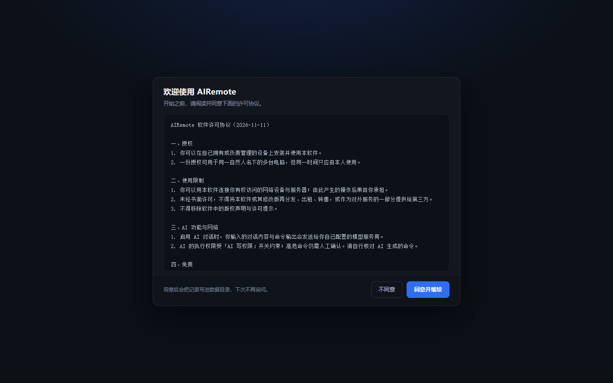 | 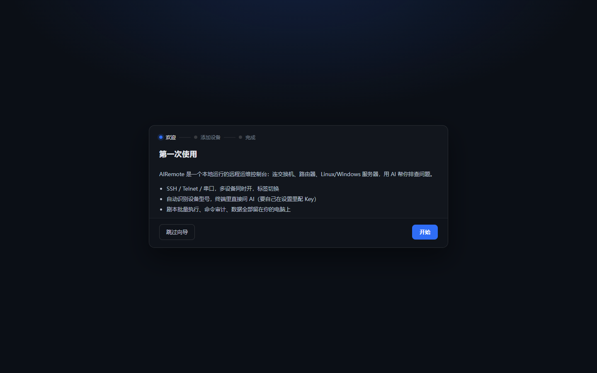 |

右上角「关于」随时可以看：版本号、数据目录位置、许可状态、检查更新。

---

## 3. 连接一台设备

在「AI 远程」页点 **＋ 新建连接**，填这些字段：

| 字段 | 说明 |
| --- | --- |
| 名称 | 显示名，例如「核心交换机 A」 |
| 协议 | SSH（默认）、Telnet、串口 |
| 文件夹 | 归到哪个分组（可多级，例如 `机房A/核心`） |
| 主机地址 | IP 或域名 |
| 端口 | SSH 默认 22，Telnet 默认 23 |
| 用户名 / 密码 | 登录凭据（落盘前加密） |
| 认证方式 | 密码 / 私钥（选私钥时填私钥路径与口令） |
| 跳板机 | 可选，经由另一台 SSH 设备转发（ProxyJump）；下拉带搜索框，可按设备名 / 主机 / 分组筛 |

串口连接额外需要选 COM 口、波特率（默认 9600）、数据位 / 校验 / 停止位。

**跳板机可以直接搜**：设备多的时候，点开「跳板机」下拉就是一个搜索框，输入设备名 / 主机 / 分组里的任意片段就能筛出来，↑↓ 选中、回车确认，Esc 关掉。

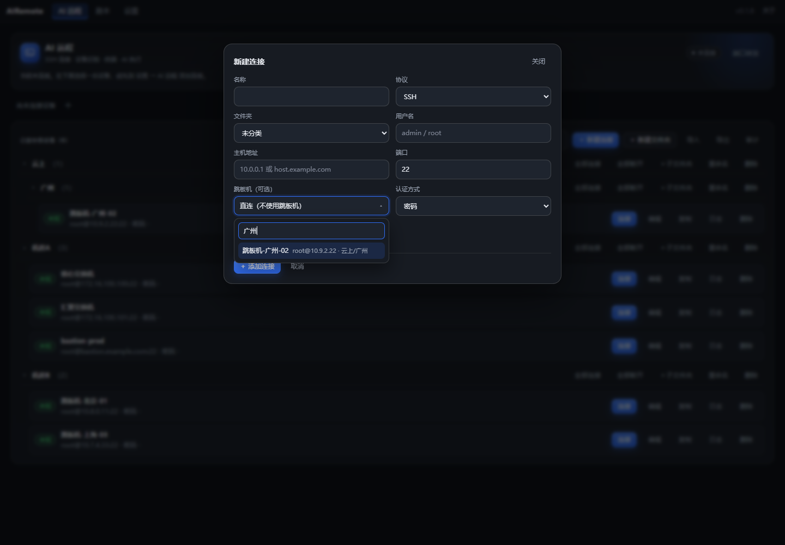

点「添加连接」保存，回到列表点 **连接** 即可。连上后会自动识别厂商与型号（华为 / 华三 / 思科 / 锐捷 / Juniper / Linux / Windows），显示在设备标题和设备详情里。

**分组与批量**

- 「＋ 新建文件夹」建分组，可多级嵌套
- 分组行上的「全部连接 / 全部断开」一次操作整组
- 「复制 / 粘贴」把设备搬到别的文件夹
- 「导入 / 导出 / 审计」见第 8 节与第 15 节

**多设备同时在线**：每连一台多一个标签页，互不打断，点标签切换。

---

## 4. 终端怎么用

连上之后主体就是终端，工具栏从左到右：

| 按钮 | 作用 |
| --- | --- |
| 查找 | 在回滚缓冲里搜关键字（带高亮与计数） |
| 清屏 | 清掉当前屏幕内容（不影响日志） |
| 重连 | 主动断开并重连 |
| 模板 | 打开命令模板（第 6 节） |
| 备份 | 打开配置备份（第 7 节） |
| A− / A+ | 字号缩小 / 放大 |
| 终端 / 文件 | 在终端与 SFTP 文件页之间切换 |
| 日志 | 看这次会话的完整日志 |

**常用操作**

- 选中文字自动复制（设置里可关）
- **复制粘贴**：终端里右键弹出菜单（复制 / 粘贴 / 全选 / 清屏）；键盘用 `Ctrl+Shift+C` 复制选区、`Ctrl+Shift+V` 粘贴。单独的 `Ctrl+C` 仍然是中断（发给设备 `^C`），不会被当成复制
- 输入框（新建连接、搜索框、AI 输入框等）里直接用 `Ctrl+C` / `Ctrl+V` / `Ctrl+X` / `Ctrl+A`，也可以右键
- 大段粘贴（超过 300 字或多行）会先弹确认，避免误把整段脚本怼进设备
- 终端支持翻页：设备侧还会分页时，按空格往下翻，AI 执行命令时会自动一次拿全
- 退格键对网络设备发 `\x08`、对 Linux 发 `\x7f`，不用手动调

**给终端腾地方**

标签行左边是设备标签（多了可以横向滚动），右边一小块是视图开关，竖线隔开、不跟设备标签混在一起：

- **广播**：把按键同时发到勾选的几台设备
- **设备管理**：把已保存设备的列表调回来 / 收起来
- **隐藏侧栏**：把右边「设备详情 + AI 对话」整块收掉，终端占满宽度（再点「显示侧栏」恢复）
- AI 对话标题旁的 **收起**：把对话面板压成一行标题

| 隐藏侧栏（终端占满） | 折叠 AI 对话 |
| --- | --- |
| 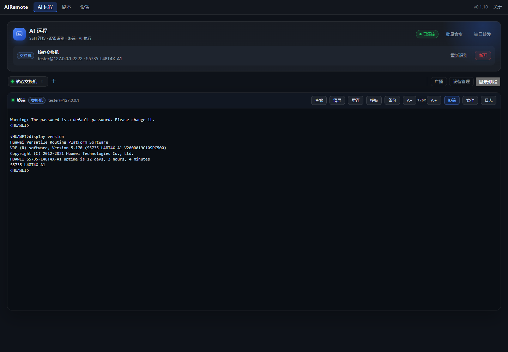 | 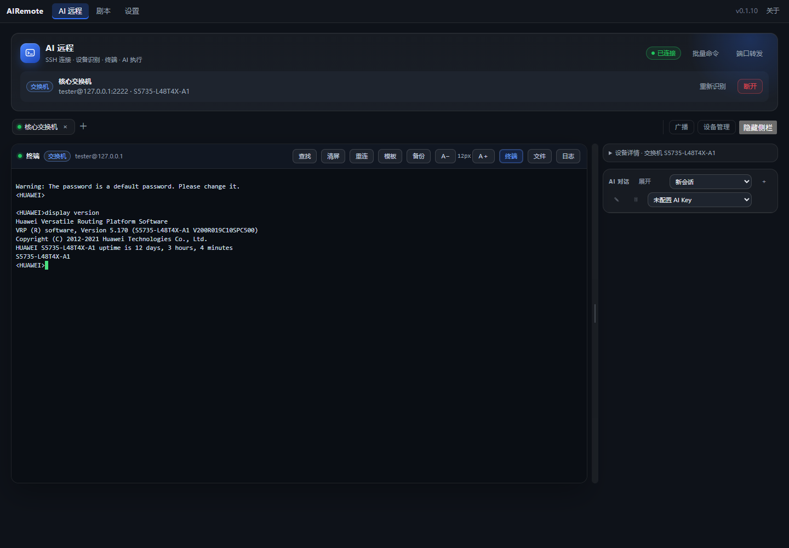 |

两个开关都记在本地，下次打开还是上次的样子。

**主动退出不重连**：你自己敲 `exit` / `quit` 让会话正常结束后，软件**不会**再自动重连；网络掉线、设备重启这类异常断开才会重连。手动点「断开」同样不重连。

软件空闲时不会往设备发任何东西（没有保活回车，也不发探测包）。会话能挂多久取决于设备上的 `exec-timeout`，想长时间挂着就把设备侧超时调长（例如华为 `idle-timeout 0 0`）。

---

## 5. AI 对话

AI 能直接读设备、跑只读命令帮你判断问题。

**先配 Key**：设置 → AI 远程 → AI 模型 →「＋ 添加」，填名称、接口地址、模型名、API Key。
支持任何 OpenAI 兼容接口（DeepSeek、OpenAI、通义、本地 Ollama 等）。Key 加密存在本机，不会上传到别处。

**怎么用**：右侧对话面板直接说人话，例如

- 「这台交换机现在 CPU 多少，有没有异常」
- 「看一下所有 down 掉的接口，列出端口和描述」
- 「帮我查一下 10.0.0.5 这台能不能 ping 通，走哪个接口」

AI 会自己调用只读命令查，把结论说给你听。

**写操作要授权**：设置里的「AI 写权限」默认关闭。打开后 AI 才能执行配置类命令，且高危命令（`reboot` / `reset` / `delete` / `save` 等）每次都要你二次确认。

**细节**

- 多会话：一个设备下可以开多个对话，互不干扰
- 可以贴图片（拓扑截图、报错截图）给 AI 看
- 生成中随时点 ⏹ 停止
- 对话长了会自动压缩历史摘要，进度和缓存命中率显示在面板底部

---

## 6. 命令模板

终端工具栏「模板」打开模板库，内置 6 条（查看版本 / 接口状态 / 路由表 / CPU / 日志尾部 / 保存配置）。

- 「＋ 新建」加自己的：填名称与命令，命令里可以用变量
  `{{host}}` 主机、`{{user}}` 用户名、`{{name}}` 设备名、`{{group}}` 分组、`{{date}}` `{{time}}` `{{year}}`
- 点「执行」直接发到当前设备，结果直接显示在模板面板里

| 命令模板 |
| --- |
| 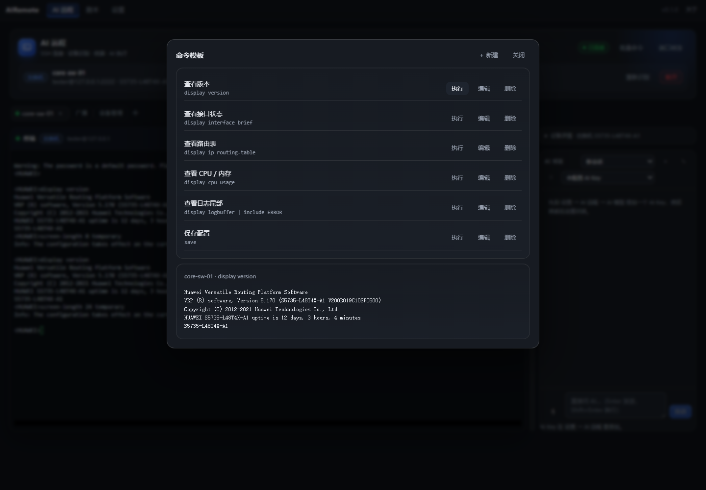 |

**广播输入**：标签栏的「广播」开关打开后，勾上的设备会同时收到你在终端里敲的按键（当前设备默认包含），适合一组设备一起敲同一条命令。

---

## 7. 配置备份与对比

终端工具栏「备份」：

1. 点 **立即备份** —— 自动按厂商挑命令（华为/华三/锐捷 `display current-configuration`、思科 `show running-config`、Juniper `show configuration | display set`、Fortinet `show full-configuration`）抓一份当前配置存下来
2. 勾任意两份点 **对比** —— 行级 diff，绿色新增、红色删除，时间戳这类每次都会变的行自动忽略
3. 可以开 **每天自动备份**，设时间与保留份数（超出自动清理旧快照）

| 配置备份与对比 |
| --- |
| 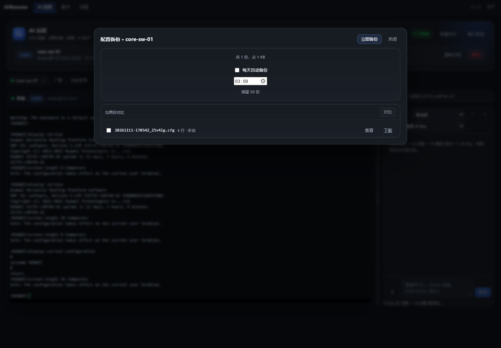 |

快照存在数据目录的 `configs\<设备名>-<id>\` 下：一份 `index.json` 记元数据，每次备份一个 `.cfg` 文件。可以在面板里查看全文或下载。

> 抓配置会以「写」的方式执行命令，命令本身是只读的，不会改设备。

---

## 8. 批量导入已有设备

「设备管理」卡片右上角 **导入**，支持三种来源：

**① Xshell**（最常用）

自动找到本机 Xshell 8/7/6/5 的会话目录（`文档\NetSarang Computer\<版本>\Xshell\Sessions`），读取主机、端口、协议、用户名、分组，**密码能解的一起带过来**。

> Xshell 的密码用「当前 Windows 账户 + 这台机器的 SID」加密。换过电脑、换过账户、重装过系统的会话解不开 —— 这类设备会把主机/端口/用户名/分组照常导入，密码留空并在预览里标「密码解不开」，连的时候补一下就行。

**② 表格 / 粘贴**

一行一台，支持表头 `主机,端口,用户名,密码,分组`（中英文表头都认），也可以直接粘 `admin@10.0.0.1:22` 这种；端口写 23 会自动当 Telnet。

**③ JSON**

本软件「导出」出来的文件可以原样导回（适合配好一套再分发）。

**导入流程**：扫描 → 预览（哪台有密码、哪台解不开、哪台没存密码，可只看有问题的）→ 勾选 → 选目标文件夹（下拉选已有的，或直接写新的，能写 `A/B` 建多级）→ 可选「保留原来的文件夹层级」→ 重复设备选跳过 / 覆盖 / 换个名字加进来 → 导入。

| 导入预览 | 导入完成 |
| --- | --- |
| 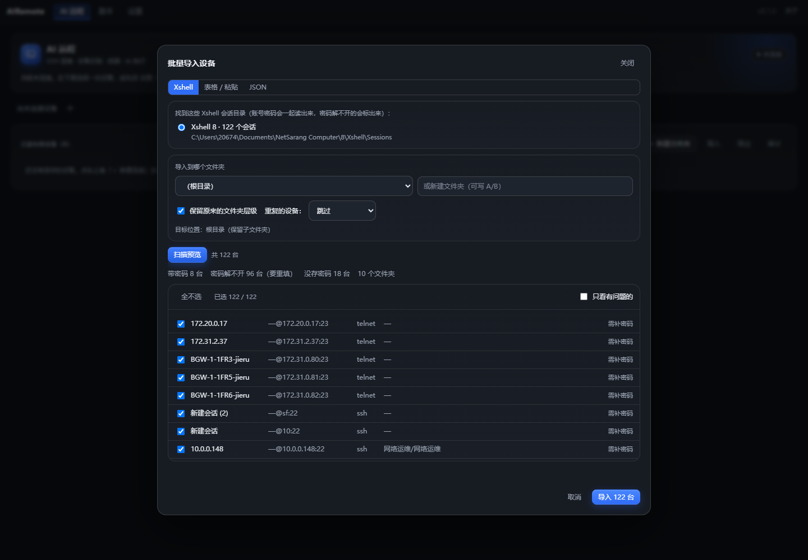 | 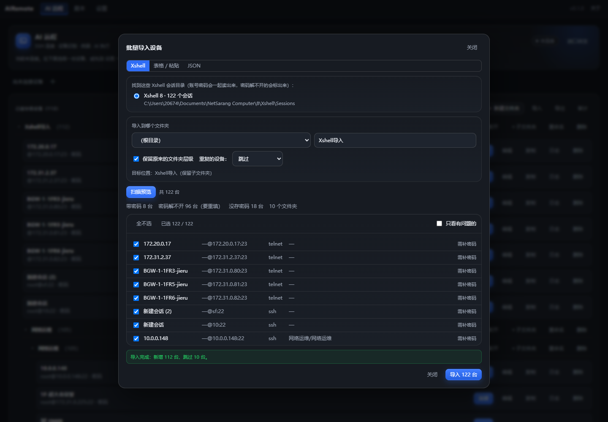 |

---

## 9. 文件传输

终端工具栏 **文件** 切到 SFTP 页（需设备开了 SSH/SFTP）：

- 左边本机、右边设备，双击进目录
- 上传 / 下载带进度条，批量勾选、整个文件夹递归都支持
- 并行读写，速度比单线程快很多
- 同名文件会提示，可以选择覆盖或跳过

**TFTP**：交换机没开 SFTP 时用 TFTP 传配置 / 镜像（设置里可改端口，默认 69 需要管理员权限，可换 6969）。

---

## 10. 端口转发

设备标题栏的 **端口转发**：

- **本地转发**：把设备侧端口映射到本机（例如设备的 80 映射成本机 8080）
- **SOCKS5**：把这台设备当代理出口
- **UDP 中继**：UDP 端口转发

列表里能看到每条隧道的连接数与流量统计，随时开关。

---

## 11. 批量命令

设备标题栏 **批量命令**：选一组设备，填一批命令，一次下发。

- 逐台显示进度与输出
- 可以随时取消
- 交互式命令（`ssh` / `telnet` / `vim` 等）会被拒绝，避免卡死

---

## 12. 剧本

「剧本」标签页把巡检流程存成可复用的步骤序列：

- 每一步可以是 **人工**（等你手动执行/确认）、**自动**（下发指定命令）、**AI**（让 AI 判断当前情况再决定）
- 执行时按步骤走，带上下文与结果，中途可暂停
- 支持导入 / 导出，方便团队之间共享巡检流程

---

## 13. 巡检与变更影响分析

两个功能都不改设备，只是「帮你多看一眼」。没配 AI Key 也能用：按关键字给出保守判断；配了 Key 会结合设备型号和最近一份配置写得更具体。

### 批量巡检

顶部「巡检」→ 选设备（默认全选）→ 选检查项（版本 / CPU 与内存 / 接口与错包 / 日志错误 / 风扇电源 / 配置保存）→「开始巡检」。

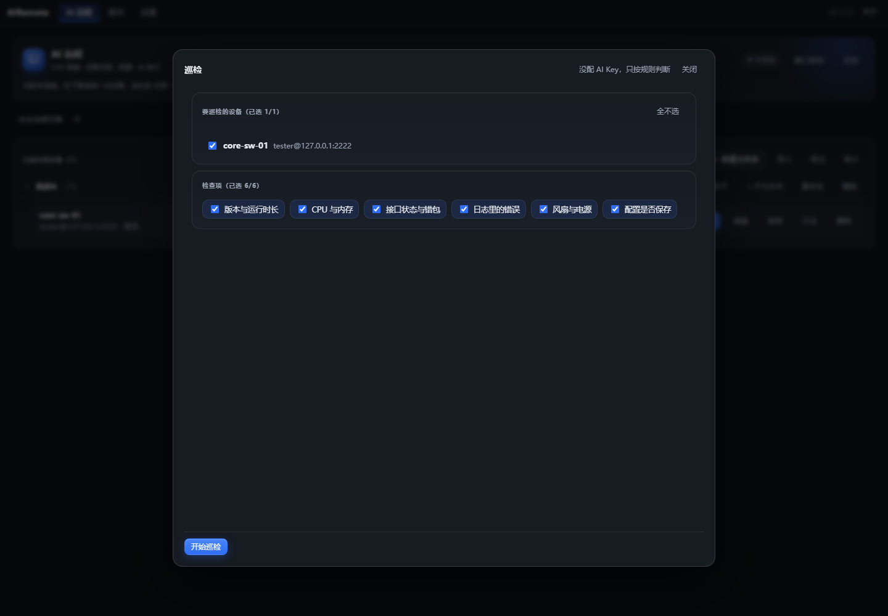

巡检会临时连上没在线的设备、跑完自动断开；左边实时显示正在查哪台、哪一项。跑完每台一张卡片：

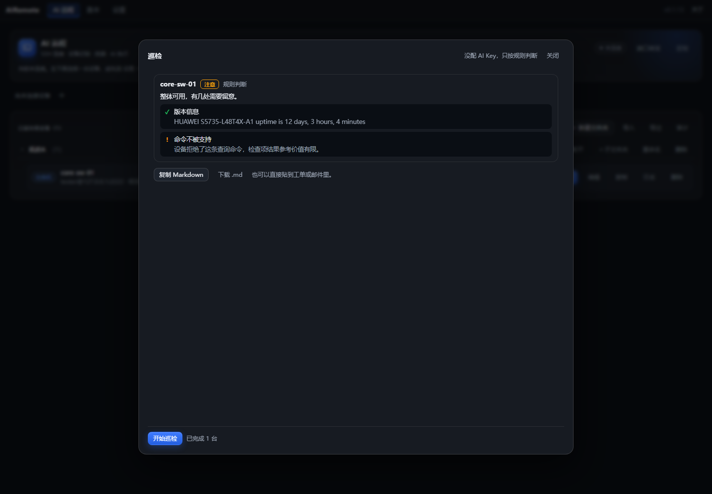

- 顶部是风险等级（**正常 / 注意 / 异常**）和一句总结
- 下面逐条列发现，前面 `✓ ! ✗` 分别对应 正常 / 注意 / 异常，带「建议：…」
- 底部「复制 Markdown」「下载 .md」，可以直接贴工单或发邮件

> 注意：巡检默认只跑查询类命令，不会动配置。全部设备跑一遍几十秒到几分钟，取决于设备数量和网络。

**没配 AI Key 时规则怎么判断**（已按真机输出校准）：

| 检查项 | 判 注意 / 异常 的条件 |
| --- | --- |
| 接口与错包 | 有端口收/发包错误计数 → 注意（单个端口 ≥1000 个错包 → 异常）；down 端口只做提示，**不算告警**（大交换机上几百个空闲口都是 down） |
| CPU 与内存 | 当前占用 ≥65% → 注意、≥85% → 异常；`Max: 72%` 这类历史峰值只做参考 |
| 日志错误 | 命中 ERROR / FAIL / CRITICAL 等关键字 |
| 风扇与电源 | 有风扇/电源「不在位」→ 异常；电源只有主用没有备用 → 注意；正常时给出风扇转速与整机功率（如「8 个风扇在线，转速 30%」「12 路电源在线，2.37 kW，主用 4 / 备用 8」） |
| 配置保存 | 超过 30 天没保存 → 注意；从来没保存过 → 注意 |
| 版本 | 只做展示（型号、软件版本、uptime、是否堆叠） |

> 已知的「不是问题」：接口表前面的图例（`*down`、`^down`）会被跳过，不会被数成 down 端口；`display saved-configuration time` 最后那句「has not been saved automatically」在有手动保存时间时不会报警。

### 变更影响分析

在终端工具栏点「影响分析」，把打算执行的命令写进去，它会告诉你：

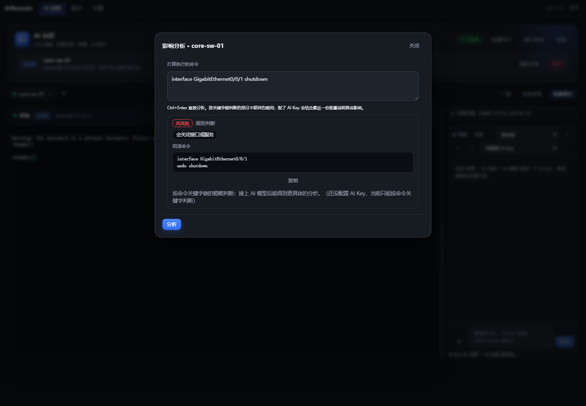

- **风险等级**：低 / 中 / 高
- **会不会断开当前会话**（`reboot`、`undo interface` 这类会）
- **影响范围**：关闭接口、删除配置、路由变更、策略变更等
- **回滚命令**：`shutdown` 给出 `undo shutdown`；`undo xxx` 给出 `xxx`；重启类明确说无法回滚
- **提醒**：需要先保存配置、注意带外通道之类的注意事项

`Ctrl+Enter` 直接分析。这部分只是辅助判断，不能替代变更评审——真正的回滚要看你原来的配置，建议先「备份」一份再改。

---

## 14. 拓扑与资产台账

顶部「拓扑」标签页有两块：**拓扑图** 和 **资产台账**。

### 拓扑自动发现

点「扫描邻居」，程序会挨台连上去读邻居信息（华为/华三/锐捷读 `display lldp neighbor`，思科读 `show lldp neighbors detail` / `show cdp neighbors detail`），然后自动拼图：

- 节点按层排：连得最多的一台放最上面，按跳数往下铺
- 连线上标出两端的端口（如 `GE0/0/1 ↔ GE0/0/24`），双向的邻居关系会合并成一条
- 已经存成连接的是实心节点（带绿点=在线），只在对端邻居里出现的是**虚框节点**，标「未保存的设备」
- 节点可以用鼠标拖着挪位置，位置记在本机，下次打开还在
- 点节点看详情：主机、厂家、邻居数；虚框节点可以直接「存成连接」
- 「连接这台」直接连上去并跳到终端

顶部那行会写：多少个节点、多少条链路、还有几台没存成连接、上次扫描时间。扫描只读邻居表，不改配置。

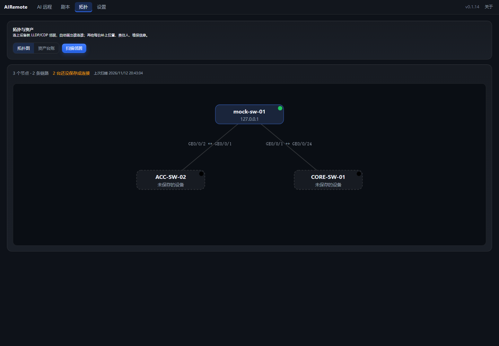

### 资产台账

切到「资产台账」，每台设备一行，能看到位置、机柜、U 位、责任人、序列号、维保到期、固件版本：

- 点行尾「编辑」填资产信息，8 个字段：位置 / 机柜 / U 位 / 责任人 / 序列号 / 维保到期 / 固件版本 / 备注
- **维保到期**会自动算状态：过期标红「已过保」，90 天内标黄「N 天后到期」，其余「维保有效」
- 「导出 CSV」把整张表导成文件（Excel 直接能开，带 BOM 不会乱码），表头是中文
- 资产信息只存在本机 `targets.json` 里，不上传

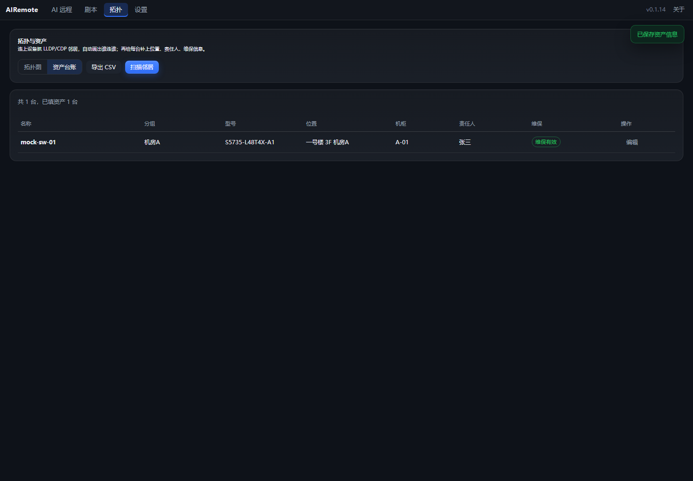

---

## 15. 日志、录像与审计

- **会话日志**：每台设备的命令与输出按时间落盘，断开之后也能在「日志」里回看
- **会话录像**：每次连接都会录一份终端录像（asciinema 格式）。在设备行的「日志」里切到「会话录像」页签，能看到每份录像的时间、时长、大小，点「回放」就像看直播一样重放当时的屏幕（颜色、清屏都在），支持暂停、拖进度、0.5×–8× 变速；「下载」拿到 `.cast` 文件，用任意 asciinema 播放器也能放
- **审计**：设备管理卡片右上角「审计」看审计日志（只记元数据：时间、来源、目标、命令摘要、结果，不记密码），可以按关键词、来源（人工 / AI / 批量 / 导入 / 备份 / 导出）和时间范围检索，结果分页
- **取证包**：审计面板里点「导出取证包」，选设备、时间范围和要打包的内容（会话日志 / 终端录像 / 命令审计），会下载一个 zip，里面有 `README.txt` 说明、`manifest.json`、`logs/`、`recordings/`、`audit/commands.jsonl`，可以直接交给别人复盘或留档
- 日志、录像、审计都在数据目录的 `logs/`、`recordings/`、`audit.log`；录像默认开、键盘输入默认不录，可以在「设置 → 记录与审计」里改

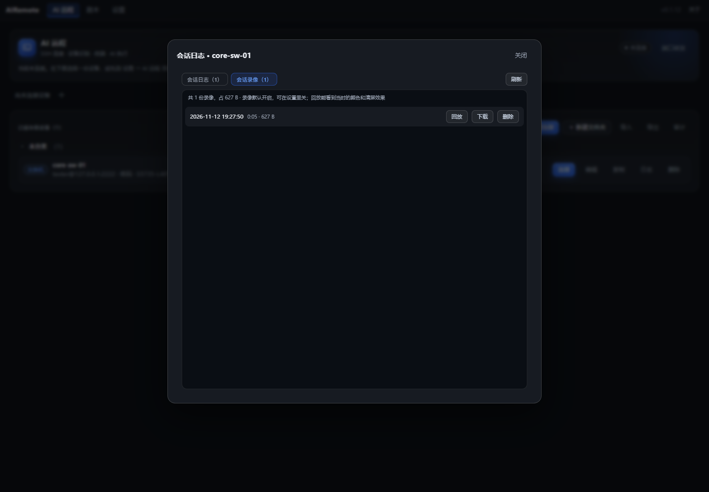

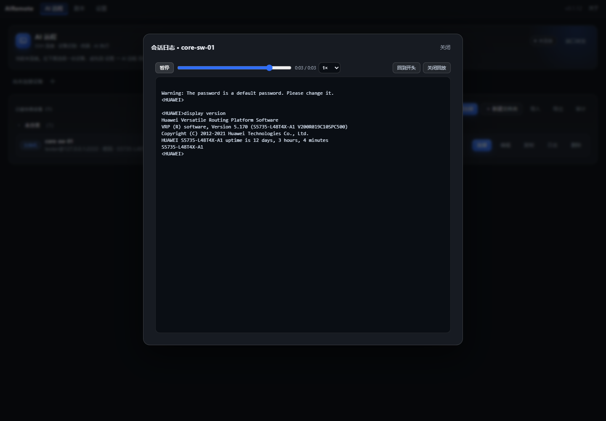

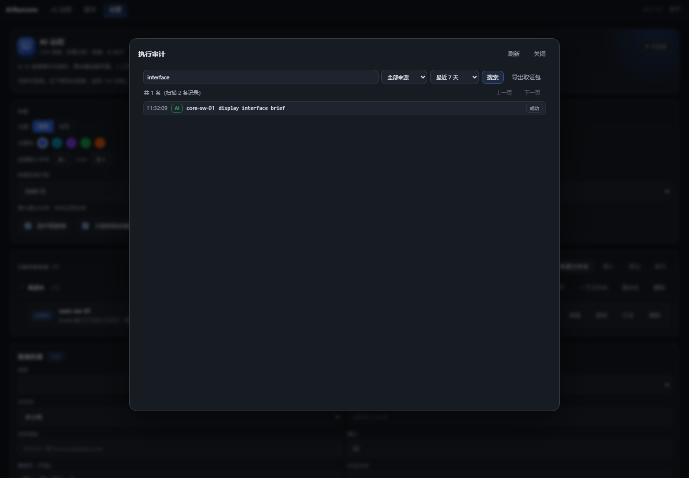

---

## 16. 设置

「设置」标签页分几块：

| 区块 | 内容 |
| --- | --- |
| 外观 | 主题（深色/浅色）、主色、终端字号、回滚行数、选中即复制、大段粘贴确认 |
| 已保存的连接 | 与主页面同一份数据，也能在这里管理 |
| 添加连接 | 新建连接的表单 |
| 数据目录 | 查看 / 切换数据目录（会把数据复制过去） |
| AI 模型 | AI Key 管理、接口地址、模型名、AI 写权限开关、上下文压缩阈值 |
| 连接行为 | 断线重连策略（指数退避 / 持续重试） |
| 记录与审计 | 是否录制终端会话、是否把键盘输入一起录（默认不录） |
| 其他 | 语言、关于 |

**主题换的是整窗**：切「浅色」后不只是卡片，标题栏、页面外的底色、终端和对话面板都会跟着变浅（0.1.10 起）；切回「深色」同理。选完立即生效，下次启动记得上次的选择。

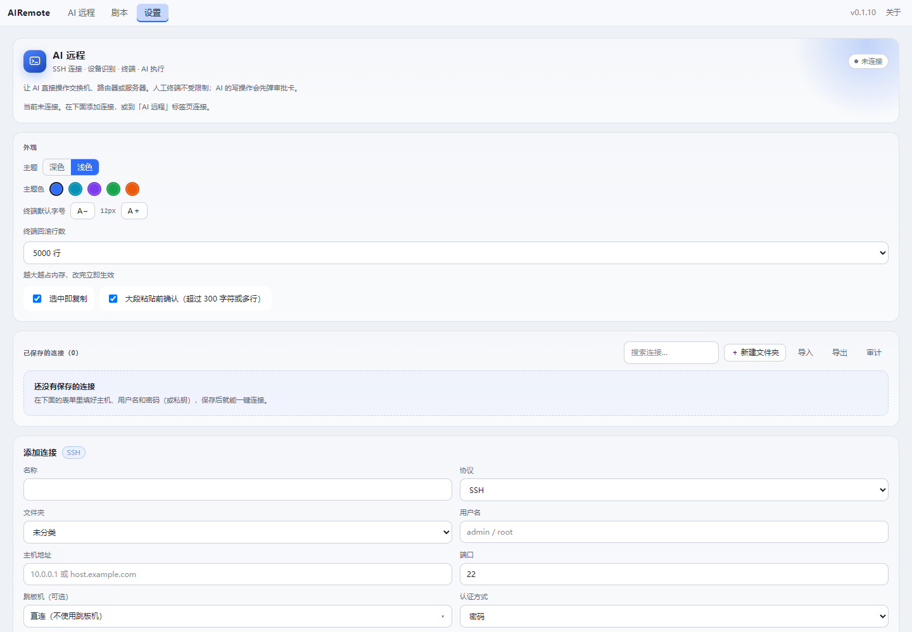

---

## 17. 自动更新

安装版自带自动更新（便携版需要手动下载新版）：

- 启动 8 秒后静默检查一次，有新版本就在后台下载
- 「关于」面板里有「检查更新」按钮，下载时显示百分比
- 下载完点 **重启并安装**：软件先退出 → 弹出安装向导自动装 → 装完自动打开
- 万一安装窗口没出来：点旁边的 **打开安装包**，在资源管理器里双击那个 exe 手动装

---

## 18. 数据目录与备份

默认在 `%APPDATA%\AIRemote\data`（在资源管理器地址栏粘贴这个路径就能打开）。

| 内容 | 文件 |
| --- | --- |
| 连接 | `targets.json` |
| AI Key | `providers.json` |
| 剧本 | `playbooks.json` |
| 外观设置 | `settings.json` |
| 命令模板 | `templates.json` |
| 许可与向导状态 | `app.json` |
| 主密钥 | `master.key` |
| 会话日志 | `logs\` |
| AI 对话 | `chats\` |
| 审计 | `audit.log` |
| 配置快照 | `configs\<设备名>-<id>\` |

**备份 / 迁移**：把这些文件整个复制走即可。注意 `master.key` 与 `targets.json` 必须一起复制 —— 密码是用它加密的；换了电脑（DPAPI 主密钥绑机器）解不开的密码需要重填。

**换目录**：设置 → 数据目录 → 切换，或启动前设环境变量 `AIREMOTE_HOME`。

---

## 19. 常见问题

**双击没反应 / 打不开**
先确认是不是被 SmartScreen 拦了（「更多信息 → 仍要运行」）。如果还是没反应，看 `%APPDATA%\AIRemote\logs\startup.log` 最后几行，那里会写渲染进程崩溃或加载失败的原因。

**提示「未知发布者」**
程序暂时没有代码签名证书，属正常现象。下载请只从 <https://github.com/Ty-206/airemote-releases/releases> 拿。

**连不上设备**
依次检查：主机地址与端口（SSH 22 / Telnet 23）、设备上是否开了对应服务、用户名密码、防火墙、是否需要用跳板机。SSH 用私钥时确认私钥路径与口令正确；老设备可能需要把算法放宽（目前 kex 已优先兼容常见老设备）。

**Xshell 密码导不进来**
密码绑定「原电脑 + 原 Windows 账户」，换过机器就解不开。主机、端口、用户名、分组会正常导入，连的时候补一次密码即可。

**复制/粘贴没反应**
终端里右键有菜单；键盘是 `Ctrl+Shift+C` / `Ctrl+Shift+V`（单独的 `Ctrl+C` 是中断，别拿它复制）。输入框里直接 `Ctrl+C` / `Ctrl+V` 就行。0.1.15 及更早的版本没有这个菜单，升级到 0.1.16 或更新版本即可。

**终端中文乱码**
多为设备侧编码（GBK）与终端（UTF-8）不一致。可先在设备上改成 UTF-8，或换用支持中文的终端编码设置。

**AI 不执行命令**
检查：AI Key 是否配好、模型是否选了、「AI 写权限」是否打开（只读命令不需要）、设备是否还连着。

**自动更新点了没反应**
点「关于 → 打开安装包」手动装一次。若仍失败，把 `%APPDATA%\AIRemote\logs\startup.log` 和 `%APPDATA%\AIRemote\pending-update.txt`（如果还在）发给开发者。

**数据会不会上传**
不会。软件只监听本机 `127.0.0.1`，连接、凭据、日志、配置全部留在本机数据目录。只有你主动使用 AI 对话时，对话内容与命令输出才会发给你自己配置的模型服务商。

---

## 反馈

问题与建议：<https://github.com/Ty-206/airemote-releases/issues>
（发布仓库只放安装包与说明，源码不在其中。）
